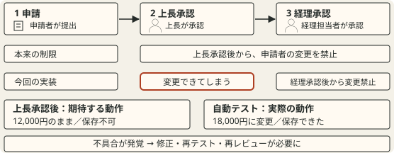
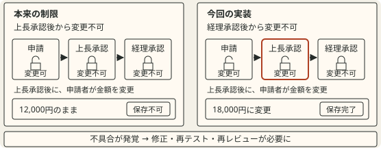

# 比較対象の所属と、違いを直接読み取れる図

AIワークショップの共通導入3枚目を修正した実例である。利用者は、変更前の「本来の制限」と「今回の実装」の境界が分かりにくく、図の見方の説明が必要になる点を指摘した。変更後の左右の図を評価し、今後の設計でも使う原則として残すよう依頼した。

## 変更前と変更後

| 変更前 | 変更後 |
|---|---|
|  |  |
| 上の承認フローと、下の制限の位置関係を読んで範囲を判断する。 | それぞれの対象の中で、状態と変更結果を読める。 |

## 何を変え、なぜ読みやすくなったか

| 変更したこと | 読み手が確認できること |
|---|---|
| 本来の制限と今回の実装を別の枠に入れる | 見出し、状態、結果がどちらに属するか分かる。 |
| 同じ承認フローを同じ位置と形で置く | 上長承認後の変更可否を直接比較できる。 |
| 異なる変更可否だけを強調する | 読み手が自分で差を探す必要がない。 |
| 同じ金額変更に対する保存結果を示す | 条件の違いで何が起きるか分かる。 |

## 適用するときの判断

一般的な原則と確認項目は `document.json` の `design-rules`、§4「比較対象の所属と、違いを直接読み取れる図」にある。この実例が持つのは適用した内容であり、原則の正本はその節である。

左右の配置や二つのカードを、すべての図に当てはめるための例ではない。一つの時間軸で連続性を示したい場合や、位置そのものに意味がある場合は、共通の軸を使う形も候補になる。枠を増やすこと自体を目的にせず、対象の所属と比較の対応を読み取れるかで判断する。

共通部分の複製で情報量が増えすぎる場合は、比較する状態や操作を減らす。文字を小さくして二つの図を収める方法を既定にしない。

## 出典と確認範囲

| 項目 | 内容 |
|---|---|
| 元の対象 | `docs/workshops/ai-workshop/review/common-intro-20261019/workspace/slide-03.*` |
| 変更前 | 同じ作業場所の `seven-slide-revision-20261019/before-slide-03-boundaries-20261021/slide-03.*` |
| 記録日 | 2026年10月21日 |
| 根拠 | 利用者の指摘、変更前後の描画、変更後への利用者の評価 |
| 限界 | この一例であらゆる比較図の理解しやすさを実証したわけではない。 |

入力は `before.source.svg` と `after.source.svg`、解決済みの表示用ファイルは `before.svg` と `after.svg` である。資料の原稿や図を後から直しても、この実例は当時の比較を残すための保存用コピーとして扱う。
