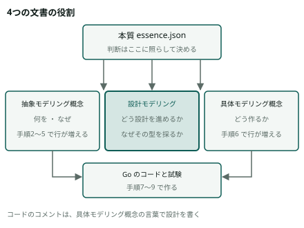
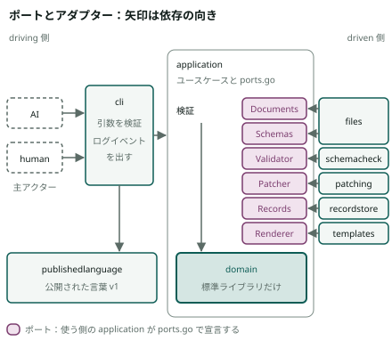
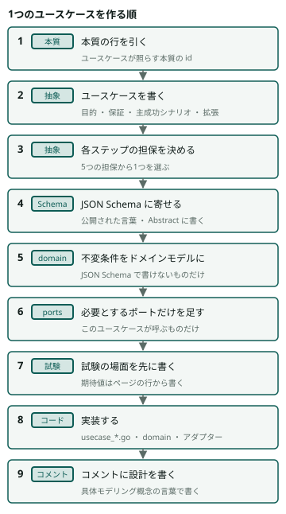
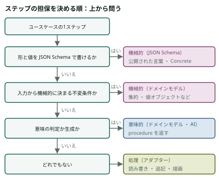
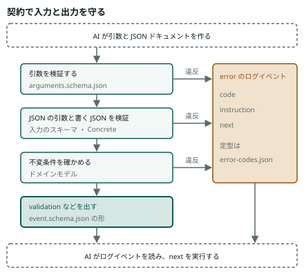

# semantic-agent-schema の設計モデリング

ユースケースを1つずつ作るときに、AI と利用者がどう設計を進めるかの手順と、なぜその型を採るかを書く。何を作るかは[抽象モデリング概念](docs/abstract-modeling/index.html)と[具体モデリング概念](docs/concrete-modeling/index.html)が持ち、ここでは繰り返さない。Go のコードと試験の決まりは [CODING.md](CODING.md) が持つ。

## 1 この文書の使い方

### 1.1 出どころの書き方

| 書き方 | 指すもの |
|---|---|
| `本質 W2` | [本質](docs/essence/index.html)（[`essence.json`](docs/essence/essence.json)）の id |
| `抽象「ドメインモデル」` | [抽象モデリング概念](docs/abstract-modeling/index.html)の節の名前 |
| `具体「ポートとアダプター」` | [具体モデリング概念](docs/concrete-modeling/index.html)の節の名前 |
| `CODING 2.3` | [CODING.md](CODING.md) の節 |
| `ports-and-adapters` | DDD の判断基準（ddd-advisor の `criteria.json`）の id |
| `uc extension` | ユースケースの判断基準（usecase-advisor の `criteria.json`）の id |
| `Cockburn L1359` | 8 の原典の、取得した原文のファイルの行。原文は英語のまま引く |

ページの行の識別子（ユースケースや不変条件の番号）は使わず、名前で書く。

### 1.2 この文書の役割

| 文書 | 持つもの | 持たないもの |
|---|---|---|
| [本質](docs/essence/index.html) | 指針。設計 ・ 実装 ・ 文書の判断は、ここに照らして決める（本質 purpose） | 手順 ・ 型 ・ 行 |
| [抽象モデリング概念](docs/abstract-modeling/index.html) | 技術に依らない「何を ・ なぜ」。ユースケース ・ 集約 ・ 不変条件 ・ ユビキタス言語（本質 D1） | Go の package ・ 型 |
| [具体モデリング概念](docs/concrete-modeling/index.html) | どう作るか。package ・ 型 ・ 列 ・ 引数（本質 D2） | 何を ・ なぜ |
| [CODING.md](CODING.md) | Go のコードと試験を書くときの決まり | 設計の進め方 |
| 設計モデリング（この文書） | どう設計を進めるか（手順）と、なぜその型を採るか（ポートとアダプター ・ 公開された言葉） | 2枚の行そのもの。ユースケース ・ 不変条件 ・ package を、ここに書き写さない |

本質 P1 は、本質の外側にポートとアダプターを置き、中心をユースケースからドメインモデルへのモデリングで設計すると決めている。この文書は、その進め方を手順にしたもの（本質 W2 ・ P1）。

## 2 ポートとアダプター ・ ヘキサゴナルアーキテクチャ

### 2.1 原典の定義

| 語 | 原文 | 出どころ |
|---|---|---|
| 目的（Intent） | "Allow an application to equally be driven by users, programs, automated test or batch scripts, and to be developed and tested in isolation from its eventual run-time devices and databases." | Cockburn L1359 |
| port と adapter | "As events arrive from the outside world at a port, a technology-specific adapter converts it into a usable procedure call or message and passes it to the application." | Cockburn L1363 |
| port | "A port identifies a purposeful conversation." | Cockburn L1517–1518 |
| port の protocol | "The protocol for a port is given by the purpose of the conversation between the two devices." | Cockburn L1464 |
| port の数 | "My selection tends to favor a small number, two, three or four ports" | Cockburn L2050 |
| ユースケースを書く所 | "the use cases should generally be written at the application boundary (the inner hexagon), to specify the functions and events supported by the application, regardless of external technology." | Cockburn L2025 |
| いちばんの利点 | "The ultimate benefit of a ports and adapters implementation is the ability to run the application in a fully isolated mode." | Cockburn L2010 |
| ドメインの分離（Evans） | "Isolate the expression of the domain model and the business logic, and eliminate any dependency on infrastructure, user interface, or even application logic that is not business logic." ／ "The key goal here is isolation." | Evans p.10 |
| Hexagonal との関係（Evans） | "may serve as well or better to the degree that they allow our domain model expressions to avoid dependencies on and references to other system concerns."（主語は Related patterns, such as “Hexagonal Architecture”） | Evans p.10 |
| ポート ・ アダプター（判断基準） | ポートは業務ロジック層が定義する抽象的なインターフェースで、インフラストラクチャ層が実装する。アダプターは、ポートを個々の技術で実装したもの。結びつけは、依存性注入か、起動時の設定で行う。ヘキサゴナルアーキテクチャは、ポートとアダプターの別名 | `ports-and-adapters` |

### 2.2 driving と driven

| 側 | 原文 | このツールで |
|---|---|---|
| primary（driving） | primary actor "is an actor that drives the application (takes it out of quiescent state to perform one of its advertised functions)."（Cockburn L1988） | 主アクターの AI と human。driving のアダプターは `cli` |
| secondary（driven） | secondary actor "is one that the application drives, either to get answers from or to merely notify."（Cockburn L1989） | ファイル ・ JSON Schema の実装 ・ SQLite ・ JSON Patch の実装 ・ テンプレートの処理系。driven のアダプターは `files` ・ `schemacheck` ・ `recordstore` ・ `patching` ・ `templates` |
| 分け方 | primary と secondary の違いは "lies in who triggers or is in charge of the conversation."（Cockburn L1991） | コマンドを実行するのが AI か human なら driving、application が呼ぶなら driven |
| 名前 | primary ・ secondary は、driving ・ driven adapters とも呼べる（Cockburn L1977–1979） | この文書は driving ・ driven を使う |

### 2.3 このツールでの当てはめ

driving 側を左、driven 側を右に置く（Cockburn L2001–2004）。ポートを宣言するのは使う側の application で、アダプターがそれを満たす（具体「ポートとアダプター」 ・ `ports-and-adapters`）。

| アダプター | 側 | 満たすポート（宣言する package） | 検証のユースケースの時点 |
|---|---|---|---|
| `cli` | driving | なし。引数を JSON にして検証し、application を呼び、ログイベントを出す | 作った |
| `files` | driven | `Documents` ・ `Schemas`（authoring ・ rendering ・ search） | `Read` ・ `Lookup` を作った |
| `schemacheck` | driven | `Validator`（全部の application） | 作った |
| `recordstore` | driven | `Records`（authoring ・ record） | `LastValidation` ・ `AppendValidation` を作った |
| `patching` | driven | `Patcher`（authoring） | まだ。更新のユースケースで足す |
| `templates` | driven | `Renderer`（rendering） | まだ。描画のユースケースで足す |
| `repository` | driven | なし。入口が一度だけ working tree と Git の共通ディレクトリを引き、各アダプターに渡す。application は Git を知らない（具体「ポートとアダプター」） | 作った |

- ポートは、使う側の application が `ports.go` に、自分のユースケースが使うメソッドだけで宣言する（具体「ポートとアダプター」 ・ [CODING 2.3](CODING.md#23-interface-は使う側に置く)）
- ポートとアダプターの結びつけは、`cmd/semantic-agent-schema/main.go` がアダプターを作って `cli` へ渡すことで行う（具体「構成」 ・ `ports-and-adapters`）
- 依存の向きは、`architecture_test.go` が `go test` の中で確かめる。domain は標準ライブラリだけを使う（具体「構成」 ・ [CODING 2.10](CODING.md#210-依存の向き)）

### 2.4 なぜこの型を採るか

| 理由 | 出どころ |
|---|---|
| 本質が、本質の外側にポートとアダプターを置き、中心をユースケースからドメインモデルへのモデリングで設計すると決めている | 本質 W2 ・ P1 |
| 中核の業務領域「作成と検証」は業務ルールが複雑なので、ドメインモデルで作る。ドメインモデルを選ぶと、技術方式はポートとアダプターになる | 抽象「業務領域」 ・ `design-heuristics` ・ `domain-model` |
| JSON Schema で書けない不変条件を、JSON Schema の実装 ・ SQLite ・ ファイルから切り離して持てる | 本質 W10 ・ E1 ・ Evans p.10 |
| CLI からも試験からも、同じ application と domain の公開の関数を呼べる | Cockburn L1359 ・ 具体「試験と完成の条件」 |
| ユースケースを境界で書けば、ステップに外の技術の語が入らない。抽象のページのユースケースは、技術に依らない | Cockburn L2025 ・ 本質 D1 |
| 試験の重点を domain の集約 ・ 値オブジェクト ・ ドメインサービスに置ける | `testing-strategy` ・ 具体「試験と完成の条件」 |

### 2.5 原典から採らないもの

| 原典にあること | このツールで | 出どころ |
|---|---|---|
| driven 側の試験の代役は mock："actor such as a database is a mock, since that is designed to answer queries or record events from the application."（Cockburn L1997） | 試験の代役のためのポートを作らない。試験は一時ディレクトリの Git と本物のアダプター（一時ファイルの SQLite）で行う | 具体「ポートとアダプター」 ・ [CODING 3.8](CODING.md#38-代役を作らず本物のアダプターで試す) ・ 本質 W6 ・ W7 |

## 3 ユースケースからドメインモデルへの探索モデリングの手順

ユースケースを1つ作るたびに、この順で最後まで行う。次のユースケースのために先に作っておかない（本質 W5 ・ W7 ・ `uc precision`）。

### 3.1 手順

| 手順 | すること | 書く所 | 次へ進む条件 |
|---|---|---|---|
| 1 本質の行を引く | ユースケースが照らす本質の id を選ぶ（本質 purpose） | ユースケースの根拠の欄 | 引いた id で、ユースケースの目的と最低保証を説明できる |
| 2 ユースケースを書く | 目的 ・ 利害関係者 ・ 成功時保証 ・ 最低保証 ・ 主成功シナリオ ・ 拡張を書く。拡張は条件を先に出し切る（本質 P3 ・ `uc main-success-scenario` ・ `uc extension` ・ `uc minimal-guarantee`） | 抽象「ユースケース」 | ステップに外の技術の語が無い（Cockburn L2025） |
| 3 各ステップの担保を決める | 3.2 の「担保の決め方」で、1つのステップに担保を1つ決める（本質 E1 ・ E2 ・ W8） | 抽象「ユースケース」のステップの右の欄 | 担保の無いステップが無い |
| 4 JSON Schema に寄せる | 形と値の決まりを、公開された言葉 ・ Abstract のスキーマに書く（本質 W5 ・ R1 ・ R3） | `internal/publishedlanguage/v1/` ・ 具体「公開された言葉」 | 形と値の違反は、JSON Schema の実装の出力を rejected に変換するだけで出る（抽象「rejected の考え方」） |
| 5 不変条件をドメインモデルにする | 4 で書けずに残った不変条件だけを、集約 ・ 値オブジェクト ・ ドメインサービスにする（本質 W10 ・ E1 ・ `aggregate` ・ `value-object` ・ `domain-service`） | 抽象「ドメインモデル」 | どの行にも「なぜ JSON Schema で書けないか」がある |
| 6 必要とするポートだけを足す | そのユースケースが外へ呼び出すメソッドだけを、ポートに足す。外部の分だけ作る（`ports-and-adapters`） | `ports.go` ・ 具体「ポートとアダプター」 | そのユースケースが呼ばないメソッドが無い |
| 7 試験の場面を先に書く | 主成功シナリオと拡張を1つずつ場面にし、期待値をページの行から書く。場面の名前は、拡張の条件の文で書く（`uc use-case-to-test-case` ・ `testing-strategy` ・ [CODING 3.7](CODING.md#37-期待値)） | `testdata/` ・ `*_test.go` ・ 具体「試験と完成の条件」 | 期待値を出力から写していない |
| 8 実装する | ユースケースの手続きを、主成功シナリオのステップの順に書く（具体「書き方の決まり」 ・ [CODING.md](CODING.md)） | `usecase_<名前>.go` ・ domain ・ アダプター | `go test ./...` と `architecture_test.go` が通る。`deadcode` で main から届かない関数が 0件（[CODING 3.10](CODING.md#310-完成の条件)） |
| 9 コメントに設計を書く | 型 ・ interface ・ 手続きのコメントに、抽象モデリングを実装としてどう具体にしたかを、具体モデリング概念の言葉で書く。3.3 の「実装のコメント」による（利用者の決定 2026-11-05 ・ [CODING 2.5](CODING.md#25-コメントと-doc)） | Go のコメント | コメントに、ページの行の識別子が無い |

### 3.2 担保の決め方

| 担保 | 書く所 | 例 | 出どころ |
|---|---|---|---|
| 機械的（JSON Schema） | 公開された言葉 ・ Abstract ・ Concrete | 検証：引数の検証 ・ Concrete での検証 | 本質 E1 ・ 抽象「機械的な検証と意味的な検証」 |
| 機械的（ドメインモデル） | domain の集約 ・ 値オブジェクト ・ ドメインサービス | 検証：作法の確認 ・ 変更点の引き継ぎ | 本質 W10 ・ E1 |
| 意味的（ドメインモデル） | domain：`x-prompt` から prompt を作る | 意味的な検証：判定の prompt を作る | 本質 E2 |
| 意味的（AI） | Semantic Agent Schema の外。AI が prompt に従う | 意味的な検証：AI が判定する | 本質 W1 ・ E2 |
| 処理 | アダプター | 検証：操作の記録に追記する | 抽象「機械的な検証と意味的な検証」 |

### 3.3 実装のコメント

実装のコメントは、設計モデリングの一部である。抽象モデリングを実装としてどう具体にしたかを、具体モデリング概念の言葉で書く。ページの行の識別子は古くなり、コードとの対応を取り続けられないので書かない（利用者の決定 2026-11-05 ・ [CODING 2.5](CODING.md#25-コメントと-doc)）。

| コメントを書く所 | 書くこと | 例 |
|---|---|---|
| 集約の型 | 集約であることと、守る不変条件 | `Validation`：集約「検証」。1つの JSON ドキュメントの1つの内容について持ち、操作の記録に追記した後は変えない |
| 値オブジェクトの型と作る関数 | 値オブジェクトであることと、作れない形 | `Path`：値オブジェクト。working tree の top-level directory からの相対のパスで、外を指す形では作れない |
| ドメインサービスの関数 | ドメインサービスであることと、決まり | `Inherited`：ドメインサービス。Concrete のハッシュが前回と同じなら、変更点でない instance location の AI の judgment を引き継ぐ |
| ポートの interface | ポートであることと、宣言する側 ・ 満たすアダプター | `Validator`：ポート。application が宣言し、`schemacheck` が満たす |
| アダプターの型 | どのポートを、どの外部で満たすか | `schemacheck.Checker`：アダプター。`Validator` を jsonschema/v6 で満たし、違反を rejected の形に変換する |
| ユースケースの手続き | ユースケースの名前と、各ステップの担保 | `Validate`：ユースケース「検証」。引数と Concrete での検証は JSON Schema、作法と変更点はドメインモデル、追記は処理 |

書かないもの：ページの行の識別子 ・ 節の番号。何をしているかだけの説明（コードを読めば分かる）。

### 3.4 やってはいけないこと

| してはいけないこと | 起きること | 代わりにすること | 出どころ |
|---|---|---|---|
| 先に枠を作る | 使うユースケースの無い package ・ interface ・ メソッドが残る | ユースケースを1つ作るたびに、そのユースケースが使うものだけを足す | 本質 W5 ・ W7 ・ 具体「ポートとアダプター」 |
| 使われない部品を作る | main から届かない関数が残る | `deadcode` で 0件にする | 具体「試験と完成の条件」 |
| Schema で済むものをコードにする | 同じ決まりが、スキーマとコードの2か所に分かれる | スキーマに書き、JSON Schema の実装の出力を rejected に変換するだけにする | 本質 W5 ・ 抽象「機械的な検証と意味的な検証」 ・ 抽象「rejected の考え方」 |
| 穴を仕組みで塞ぐ | 入力の曖昧さを補うアルゴリズムや、外の変更の取り込みの仕組みが増える | 足りない入力は rejected で AI に指示と next を返す。変更点は前回の検証と比べて出す | 本質 R5 ・ 抽象「変更点の求め方」 ・ 抽象「境界」 |
| コードや試験にページの行の識別子を書き、対応を数える | 識別子が古くなり、対応が取れなくなる | コメントに、具体モデリング概念の言葉で設計を書く | 利用者の決定 2026-11-05 |
| 試験の代役のためにポートを作る | ポートが外部の数より増える | 本物のアダプターで試験する | 具体「ポートとアダプター」 ・ [CODING 3.8](CODING.md#38-代役を作らず本物のアダプターで試す) |

## 4 例：検証のユースケースで手順を通した姿

| 手順 | したこと | 書いた所 |
|---|---|---|
| 1 | 本質 W1 ・ E1 ・ E5 ・ R1–R5 ・ W5 ・ W10 を引いた | 抽象「ユースケース」の検証 |
| 2 | 目的 ・ 利害関係者 ・ 成功時保証 ・ 最低保証 ・ 5つのステップと、拡張（違反がある ・ Concrete が schemas に無い ・ 範囲の path のファイルが無い ・ Git のリポジトリの外で操作の記録に追記できない）を書いた | 抽象「ユースケース」の検証 |
| 3 | 引数の検証と Concrete での検証は機械的（JSON Schema）、作法の確認と変更点の引き継ぎは機械的（ドメインモデル）、操作の記録への追記は処理 | 抽象「ユースケース」の検証 |
| 4 | `validate` の引数の形と path の pattern、拡張項目の閉じた一覧（`propertyNames`）、`x-view` はルートだけ（`"x-view": false`）、`x-decided-by` は `const` の `human`、ログイベント validated ・ rejected の形 | `arguments.schema.json` ・ `vocabulary.schema.json` ・ `dialect.schema.json` ・ `abstract.schema.json` ・ `event.schema.json` |
| 5 | 値オブジェクト path ・ 主アクター ・ ハッシュ ・ judgment、ドメインサービス `Convention`（作法）・ `ChangedLocations` ・ `Inherited`（変更点）、集約 検証 `Validation`（counts） | `internal/authoring/domain/` |
| 6 | 4つのポートの5つのメソッド：`Documents.Read` ・ `Schemas.Lookup` ・ `Validator.Check` ・ `Records.LastValidation` ・ `Records.AppendValidation`。`Patcher` ・ `Renderer` ・ `Documents.Write` ・ `Records.WithLock` は作っていない | `internal/authoring/application/ports.go` |
| 7 | システムテスト 14場面。domain のコンポーネントテスト（path ・ 主アクター ・ 作法 ・ 変更点 ・ counts）。`schemacheck` ・ `recordstore` ・ `publishedlanguage` の試験 | `cmd/semantic-agent-schema/testdata/` ・ `*_test.go` |
| 8 | `usecase_validate.go` が、主成功シナリオのステップの順に手続きを並べる。`main.go` がアダプターを作って `cli` へ渡す | `internal/authoring/application/usecase_validate.go` ・ `cmd/semantic-agent-schema/main.go` |
| 9 | まだ。いまのコメントと試験はページの行の識別子を持つので、3.3 の形に書き直す | `internal/` ・ `cmd/` のコメント |

path の形は、`arguments.schema.json` の pattern と、値オブジェクト path の作る関数の両方で確かめる。値オブジェクトの作る関数は不変条件を検証する決まりによる（具体「書き方の決まり」 ・ [CODING 2.6](CODING.md#26-値オブジェクトと空の値)）。シンボリックリンクの先は `files` が確かめる。

## 5 JSON Schema を公開された言葉（契約）とする

### 5.1 原典の定義

| 語 | 原文 ・ 定義 | 出どころ |
|---|---|---|
| Open-host Service | "Define a protocol that gives access to your subsystem as a set of services." "Open the protocol so that all who need to integrate with you can use it." | Evans p.35 |
| 上流と下流 | "This places the provider of the service in the upstream position." "Each client is downstream" | Evans p.35 |
| Published Language | Use a well-documented "shared language that can express the necessary domain information as a common medium of communication" | Evans p.36 |
| 内部のモデルを交換に使わない理由 | 内部のモデルを交換の言葉に使うと "it essentially becomes frozen and cannot respond to new development needs." | Evans p.36 |
| 2つの組み合わせ | "Published language is often combined with" open-host service. | Evans p.36 |
| 共用サービス ・ 公開された言葉（判断基準） | 上流が、内部のモデルから切り離した公開された言葉を提供し、下流を内部の変更から保護する。公開された言葉は、内部の言葉に一致させず、連係の用途に特化した言葉として定義する | `open-host-service` |
| 従属する関係（判断基準） | 下流が、上流のモデルを変えずに受け入れて従う | `conformist` |
| JSON Schema の役目 | "JSON Schema establishes a common language for data exchange" | JS what-is L4 |
| 契約としての使い方 | "Good definitions of input/output that schemas provide enable contract and property-based testing scenarios." ／ "They want to make sure that both applications accept or reject JSON with identical behavior, so they write a single JSON Schema and deploy it to both applications." | JS use-cases L1 |
| vocabulary ・ dialect | "A vocabulary consists of a list of keywords, together with their syntax and semantics." "A dialect is defined as a set of vocabularies and their required support identified in a meta-schema." | JS Core L1756 ・ L1758 |
| meta-schema と `$schema` | "A schema that itself describes a schema is called a meta-schema." "The current schema MUST be valid against the meta-schema identified by this URI." | JS Core L2057 ・ L2851 |
| `$id` | The "$id" "keyword identifies a schema resource with its" canonical URI. "Note that this URI is an identifier and not necessarily a network locator." | JS Core L2996 ・ L2999 |
| 拡張のキーワード | "Additional schema keywords and schema vocabularies MAY be defined by any entity." "Save for explicit agreement, schema authors SHALL NOT expect these additional keywords and vocabularies to be supported by implementations that do not explicitly document such support." | JS Core L2252–2253 |
| 拡張の処理の登録 | "Implementations MAY provide the ability to register or load handlers for vocabularies that they do not support directly." | JS Core L2259 |

Semantic Agent Schema は上流で、AI と人は下流。AI と人へは共用サービス、デザインシステムを作る人とは従属する関係（抽象「業務領域」 ・ `open-host-service` ・ `conformist`）。

### 5.2 このツールで契約になるもの

| 契約 | ファイル（`internal/publishedlanguage/v1/`） | 作る側 → 読む側 | 検証のユースケースの時点 |
|---|---|---|---|
| 入力の引数 | `arguments.schema.json` | AI ・ human → `cli` | ある（validate） |
| JSON の引数 | `patch.schema.json` ・ `judgment-response.schema.json` ・ `search-response.schema.json` | AI → application | まだ（更新 ・ 意味的な検証 ・ 検索） |
| ログイベント | `event.schema.json` | Semantic Agent Schema → AI | ある（validated ・ rejected） |
| rejected | `event.schema.json` の rejected と `error-codes.json`（code ごとの instruction と next の定型） | Semantic Agent Schema → AI | ある |
| prompt | `prompt.schema.json`（`*_requested` のログイベント） | Semantic Agent Schema → AI | まだ（作成 ・ 更新 ・ 意味的な検証 ・ 検索） |
| response | `judgment-response.schema.json` ・ `search-response.schema.json` | AI → application | まだ（意味的な検証 ・ 検索） |
| デザインシステム | `design-system.schema.json` ・ `template-language.json` | 使う側 → rendering | まだ（描画） |
| Abstract と拡張項目 | `abstract.schema.json` ・ `vocabulary.schema.json` ・ `dialect.schema.json` | Concrete を書く人 ・ AI → application | ある |

ファイルの一覧は具体「公開された言葉」による。どれもバイナリに埋め込む。

### 5.3 契約の版の上げ方

前の版は残さず、一度に新しい版へ移す。後方互換は作らない（具体「公開された言葉」 ・ 利用者の決定 2026-11-05）。

| 変更 | 版 | なぜ |
|---|---|---|
| 前は通った入力を拒否する ・ 出力の形を変える ・ 拡張項目の意味を変える | `v1/` を `v2/` に置き換え、どのファイルの `$id` も `urn:semantic-agent-schema:<名前>:v2` にする | `$id` は schema resource を指す識別子（JS Core L2996）。Concrete は `$schema` に Abstract の `$id` を書くので、同じ `$id` の中身を変えると、Concrete が知らないうちに違反になる（`abstract.schema.json` の description） |
| 受け入れる入力を増やすだけ ・ description を直すだけ | 同じ `$id` のまま | 下流の入力と出力が変わらない（`open-host-service`） |

1. `v1/` を `v2/` に置き換え、`$id` と `publishedlanguage.go` の `$id` の定数を一度に変える
2. 試験の期待値をページの行から書き直す（3.1 の手順 7）
3. Concrete を書く人は、Concrete の `$schema` を v2 の `$id` に変える

判断基準は、版を並べて出すと下流が移りやすいと挙げる（`open-host-service`）。このツールは、並べて出すことを採らない。

### 5.4 依存の注入は、契約の依存だけを受け入れる

| 注入するもの | 契約（Semantic Agent Schema が決める） | 内容（使う側が渡す） | 出どころ |
|---|---|---|---|
| デザインシステム | `design-system.schema.json` ・ `template-language.json`。テンプレートに渡すのは `.Value` と `.Tokens` だけ | テンプレート ・ デザイントークン | 本質 W4 ・ C6 ・ 具体「公開された言葉」 ・ `conformist` |
| Concrete | Abstract ・ 拡張項目の vocabulary ・ dialect | 用途ごとのプロパティ ・ rule | 本質 W4 ・ C2 ・ C5 |

- 拡張項目は、vocabulary として明示して登録する（`RegisterVocabulary`）。JSON Schema の実装は、明示した合意の無い拡張のキーワードを扱わない（JS Core L2253 ・ L2259 ・ 具体「使うライブラリ」）
- 契約に無い形の依存は受け入れない。テンプレートの `Funcs` は呼ばない（本質 C6 ・ 具体「使うライブラリ」）
- Concrete の具体の内容には依存しない（本質 C5）

### 5.5 機械的な検証で入力と出力を守る流れ

検証のユースケースでは、範囲の JSON ドキュメントの違反は rejected にせず、violated として数える（抽象「ユースケース」の検証の拡張）。全部の出力は、試験が `event.schema.json` で検証する（具体「試験と完成の条件」）。

- JSON Schema の違反は、JSON Schema の実装の出力を rejected に変換するだけで、独自の判定を足さない（抽象「rejected の考え方」）
- rejected の instruction と next は、`error-codes.json` の定型に instance location と値を入れて作る。AI はそれを読んで次のアクションを取る（本質 W5 ・ R5）

## 6 用語

この文書は、抽象「ユビキタス言語」の語を使う。driving ・ driven、vocabulary ・ dialect、共用サービス ・ 公開された言葉も、そこにある。そこに無い語は、下の表の語だけを使う。

| 用語 | 意味 | 出どころ |
|---|---|---|
| 担保 | ステップを何で確かめるか。3.2 の5つから1つ | 抽象「ユースケース」 |
| `x-prompt` と prompt | `x-prompt` は Concrete のサブスキーマに書く拡張項目（元）で、スキーマの側だけ。いつも `x-` を付けて書く。prompt は、コマンドが `x-prompt` から作って `*_requested` のログイベントで AI に返すもので、出力の側だけ。2つを混ぜて書かない | 抽象「ユビキタス言語」 |
| response | AI が prompt に従って作り、コマンドへ渡す JSON（引数は `--response`） | 抽象「ユビキタス言語」 |
| ログイベントの名前 | ユースケースで起きたことの過去形（`created` ・ `validated` ・ `judgment_requested` ・ `rejected` など）。一覧は具体「公開された言葉」 | 具体「公開された言葉」 |

## 7 図の置き場所

図は `docs/design-modeling/figs/` に置く。`*.source.svg` が class で書いた元で、`*.svg` は design-svg の `resolve` が値に解決したもの。図を直すときは `*.source.svg` を直して `resolve` し直す。

## 8 原典

どれも fact-check で原文を取得し、引用は原文の文字列で照合した。取得した原文はリポジトリに置かず、下の URL と sha256 で同じ版を引き直せるようにする。

| 略号 | URL | 取得したファイルの名前 | 取得した日 | sha256 の先頭 |
|---|---|---|---|---|
| Cockburn | https://alistair.cockburn.us/hexagonal-architecture/ （2005-09-04 の HaT Technical Report） | `alistair.cockburn.us_hexagonal-architecture` | 2026-11-05 | 8632333bb658 |
| Evans | https://www.domainlanguage.com/wp-content/uploads/2016/05/DDD_Reference_2015-03.pdf （Domain-Driven Design Reference、2015） | `www.domainlanguage.com_wp-content_uploads_2016_05_DDD_Reference_2015-03.pdf`。照合は pdftotext の出力 `ddd-reference.txt` で行った | 2026-11-05 | cf82dc7b4736 |
| JS Core | https://json-schema.org/draft/2020-12/json-schema-core | `json-schema.org_draft_2020-12_json-schema-core` | 2026-11-05 | 5b149bd83771 |
| JS what-is | https://json-schema.org/overview/what-is-jsonschema | `json-schema.org_overview_what-is-jsonschema` | 2026-11-05 | bb2a7c8b5c52 |
| JS use-cases | https://json-schema.org/overview/use-cases | `json-schema.org_overview_use-cases` | 2026-11-05 | 4b66c77dc481 |
